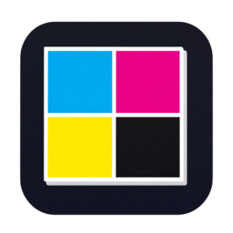
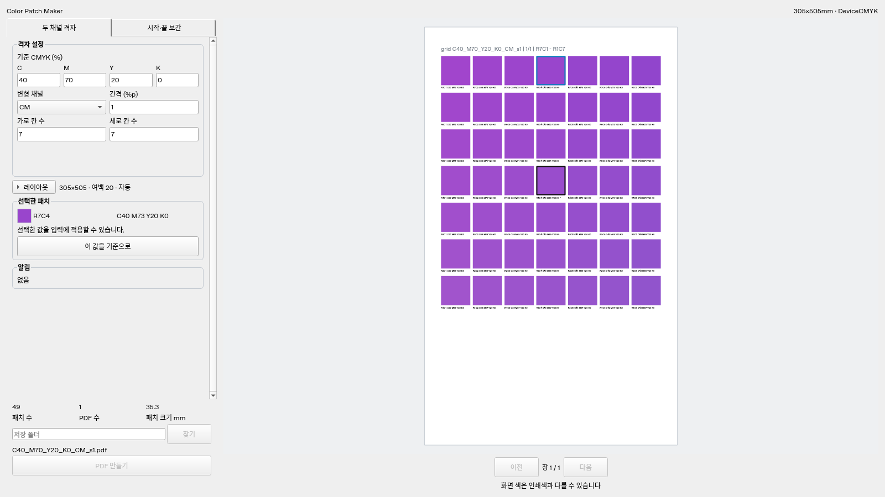
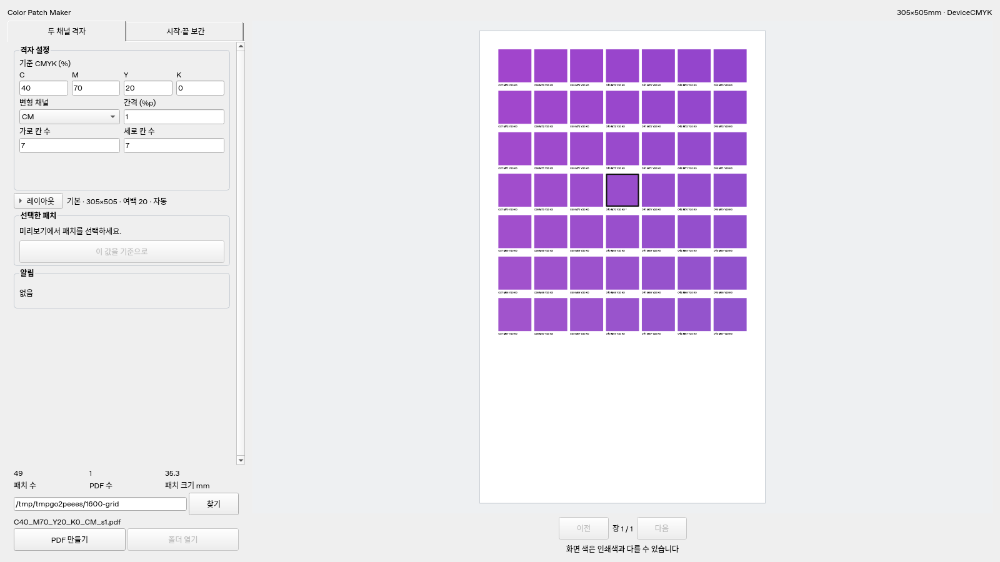
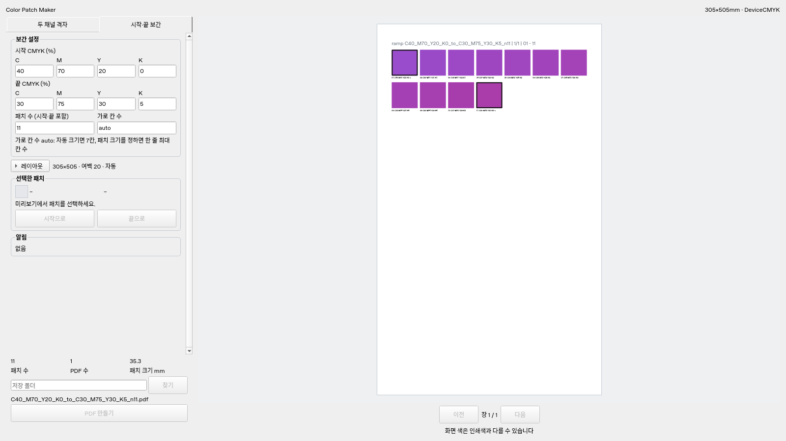

<p align="center">
  
</p>

<h1 align="center">Color Patch Maker</h1>

<p align="center">
  원하는 색을 찾을 때까지, 필요한 만큼만 정확하게 뽑는 CMYK 패치 차트
</p>

<p align="center">
  <a href="https://drive.google.com/file/d/1jVFRYr7_GB6gT_6guhcR8KIbclYbl9Ag/view?usp=sharing"><b>Windows용 내려받기</b></a> · Windows 10/11 x64 · ZIP 약 87MB
</p>

<p align="center">
  
</p>

인쇄한 색이 실물 견본과 다를 때, 숫자를 조금씩 바꿔 가며 다시 뽑아 보는 일은 번거롭습니다. Color Patch Maker는 원본 CMYK 값을 넣으면 그 주변 색을 규칙대로 펼친 패치 차트를 인쇄용 PDF로 만들어 줍니다. 인쇄물을 견본 옆에 놓고 가장 가까운 패치를 고르면, 라벨에 적힌 CMYK 값을 그대로 쓰면 됩니다.

## 이렇게 씁니다

1. 맞추려는 색의 CMYK 값을 입력합니다.
2. 패치 방식과 간격을 고르고, 미리보기로 배치를 확인합니다.
3. PDF를 만들어 인쇄합니다.
4. 실물 견본과 비교해 가장 가까운 패치를 고릅니다.
5. 그 값으로 확정하거나, 미리보기에서 그 패치를 눌러 새 기준으로 다시 만듭니다.

## 두 가지 패치 방식

### 두 채널 격자

기준 색을 가운데 두고, 두 채널을 가로·세로로 일정 간격씩 바꿉니다. 나머지 두 채널은 그대로입니다. "마젠타를 조금 빼고 시안을 조금 넣으면 맞을 것 같은데"처럼 두 채널을 같이 조정할 때 씁니다.

- 채널 조합: CM, CY, CK, MY, MK, YK
- 간격: 1%p부터 원하는 정수
- 칸 수: 가로·세로 각각, 기본 7×7

<p align="center">
  
</p>

### 시작·끝 보간

시작 색과 끝 색 사이를 패치 수만큼 고르게 나눕니다. 네 채널이 함께 바뀌므로, 세 채널 이상을 같이 손봐야 할 때나 앞서 고른 두 후보 사이를 촘촘히 볼 때 씁니다.

예: C40 M70 Y20 K0 → C30 M75 Y30 K5, 패치 11개

| 패치 | 01 | 02 | 03 | 04 | 05 | 06 | 07 | 08 | 09 | 10 | 11 |
| --- | --- | --- | --- | --- | --- | --- | --- | --- | --- | --- | --- |
| C | 40 | 39 | 38 | 37 | 36 | 35 | 34 | 33 | 32 | 31 | 30 |
| M | 70 | 71 | 71 | 72 | 72 | 73 | 73 | 74 | 74 | 75 | 75 |
| Y | 20 | 21 | 22 | 23 | 24 | 25 | 26 | 27 | 28 | 29 | 30 |
| K | 0 | 1 | 1 | 2 | 2 | 3 | 3 | 4 | 4 | 5 | 5 |

<p align="center">
  
</p>

## 인쇄 현장에 맞춘 출력

- **정수 CMYK만 씁니다.** 인쇄기가 정수값만 출력하므로 모든 패치 값과 라벨이 정수입니다. 소수를 넣으면 반올림하지 않고 알려 줍니다.
- **한 파일은 한 페이지입니다.** 페이지를 구분하지 못하는 RIP에서도 그대로 쓸 수 있습니다. 패치가 한 장에 다 들어가지 않으면 `_01`, `_02`처럼 단일 페이지 PDF 여러 개로 나눕니다.
- **패치마다 CMYK 값을 적습니다.** 인쇄물에서 바로 읽어 쓸 수 있습니다. 기준 색과 시작·끝 패치는 따로 표시합니다.
- **색은 벡터로 저장하고 다시 확인합니다.** 모든 패치는 DeviceCMYK 벡터로 저장되고, 만든 뒤 PDF를 다시 읽어 값과 위치가 맞는지 검사합니다.
- **기존 파일을 덮어쓰지 않습니다.** 파일 이름에 입력값이 들어가고(예: `C40_M70_Y20_K0_CM_s1.pdf`), 같은 이름이 있으면 `_v2`를 붙입니다.
- **0~100%를 넘는 값은 0과 100으로 맞춥니다.** 격자 끝이 범위를 벗어나면 경고를 보여주고, 같은 값이 된 패치도 그대로 출력합니다.

## 화면

| 영역 | 하는 일 |
| --- | --- |
| 방식 탭 | 두 채널 격자와 시작·끝 보간을 바꿉니다. 탭마다 입력값이 따로 남습니다. |
| 설정 | CMYK와 간격·칸 수를 넣습니다. 잘못된 값은 칸 바로 아래에 알려 줍니다. |
| 레이아웃 | 용지(기본 305×505mm), 여백(기본 20mm), 패치 크기(자동 또는 mm), 패치 간격을 바꿉니다. |
| 미리보기 | 용지 비율 그대로 패치 배치를 보여주고, 여러 장이면 장을 넘겨 봅니다. |
| 선택한 패치 | 미리보기에서 누른 패치의 값을 보여주고, 다음 작업의 기준·시작·끝으로 넣습니다. |
| 알림·저장 | 경고와 결과를 보여주고, 저장 폴더를 골라 PDF를 만듭니다. |

PDF를 만드는 동안에도 화면은 멈추지 않습니다. 끝나면 만들어진 파일 목록과 검사 결과를 보여주고, **폴더 열기**로 바로 이동할 수 있습니다. 저장 폴더와 레이아웃 설정은 다음 실행 때 그대로 돌아옵니다.

레이아웃을 펼치면 **기본**(305×505mm)과 **카드**(85.6×54mm)를 고를 수 있습니다. 자주 쓰는 용지·여백·패치 간격·크기는 **템플릿 저장**으로 이름을 붙여 보관하세요. 같은 이름으로 저장하면 덮어쓸지 확인하며, 직접 만든 템플릿만 삭제할 수 있습니다. **기본값으로 되돌리기**는 레이아웃만 되돌리고 색과 칸 수, 저장 폴더는 유지합니다.

카드는 여백 2mm·패치 크기 18mm로 한 장에 최대 8개(4×2)가 들어갑니다. 7×7 격자는 PDF 8개, 3×3은 2개로 나뉘며 모든 CMYK 값의 라벨을 담을 수 있습니다.

## 명령줄로 쓰기

반복 작업에는 같은 기능을 명령줄 프로그램 `cpm.exe`로도 쓸 수 있습니다. `cpm.exe`는 내려받은 ZIP에 함께 들어 있습니다.

```powershell
cpm.exe grid --cmyk 40 70 20 0 --channels CM --step 1 --cols 7 --rows 7 --out-dir output
cpm.exe ramp --from 40 70 20 0 --to 30 75 30 5 --count 11 --out-dir output
cpm.exe verify output\C40_M70_Y20_K0_CM_s1.pdf output\C40_M70_Y20_K0_CM_s1.json
```

명령줄에서는 `--template card`(또는 `카드`)로 카드 레이아웃을 씁니다. `default`(또는 `기본`)도 사용할 수 있으며, 함께 넣은 `--paper`, `--margin`, `--gap`, `--patch-size` 값이 템플릿보다 우선합니다. 직접 저장한 템플릿은 GUI에서 사용하세요.

```powershell
cpm.exe grid --cmyk 40 70 20 0 --cols 3 --rows 3 --template card --out-dir cards
```

## 내려받기와 설치

Windows 10/11 x64용입니다. 설치 과정 없이 압축만 풀어서 실행합니다.

1. [ColorPatchMaker.zip 내려받기](https://drive.google.com/file/d/1jVFRYr7_GB6gT_6guhcR8KIbclYbl9Ag/view?usp=sharing) (Google Drive, 약 87MB)
2. 압축을 원하는 위치에 풉니다.
3. 압축을 푼 폴더에서 `ColorPatchMaker.exe`를 실행합니다. 명령줄 프로그램 `cpm.exe`도 함께 들어 있습니다.

- 실행 파일만 따로 옮기지 마세요. 같은 폴더의 `_internal` 폴더가 함께 있어야 실행됩니다. 옮길 때는 폴더째 옮깁니다.
- 서명하지 않은 프로그램이라 처음 실행할 때 Windows에서 "Windows의 PC 보호" 경고가 나올 수 있습니다. **추가 정보 → 실행**을 누르면 됩니다. 회사 PC에서 막히면 관리자에게 문의하세요.
- Python을 따로 설치하지 않아도 됩니다.
- 직접 빌드하려면 [Windows 빌드 안내](docs/BUILD_WINDOWS.md)를 따릅니다.

## 알아 두세요

- 화면의 색은 참고용입니다. 색 판단은 반드시 인쇄물로 합니다.
- PDF에 저장된 CMYK 값은 검사하지만, RIP나 인쇄기가 색을 바꾸는 경우까지 보증하지는 않습니다.
- 인쇄물에는 헤더 없이 CMYK 값만 한 줄로 표시합니다. 기준색은 `*`, 보간 시작·끝은 `>`·`<`로 구분합니다. 패치 ID는 화면에서 선택할 때 확인할 수 있습니다.
- 라벨은 폭에 맞춰 7pt에서 최소 4.5pt까지 줄입니다. 이 크기도 확보할 수 없으면 패치 크기를 키우거나 칸 수를 줄이라고 알려 줍니다. 기본 용지와 카드에 시험 인쇄해 작은 글자가 읽히는지 확인하세요.

## 개발자용 문서

- [개발 안내](docs/DEVELOPMENT.md): 소스 실행, 테스트, 엔진 구조
- [설계 문서](docs/DESIGN.md): 기능과 화면의 기준
- [진행상황](docs/PROGRESS.md): 개발 단계와 검증 결과
- [작업 규칙](AGENTS.md): 기여 전에 읽어 주세요
